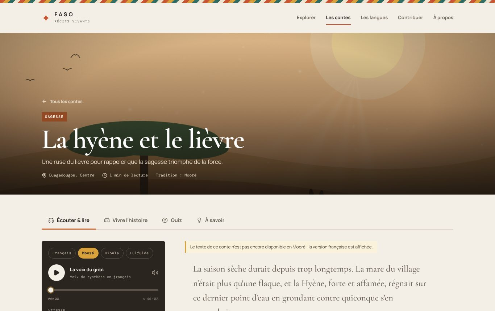
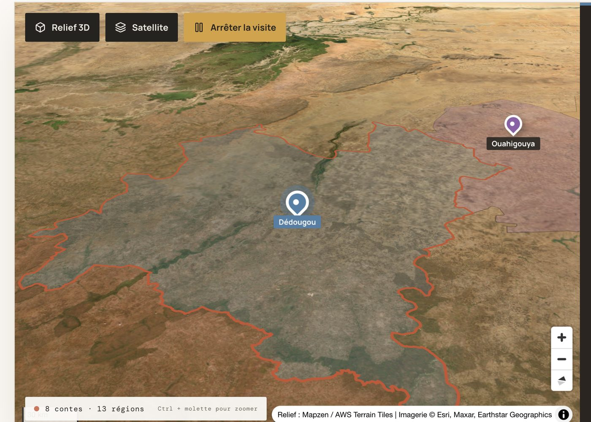
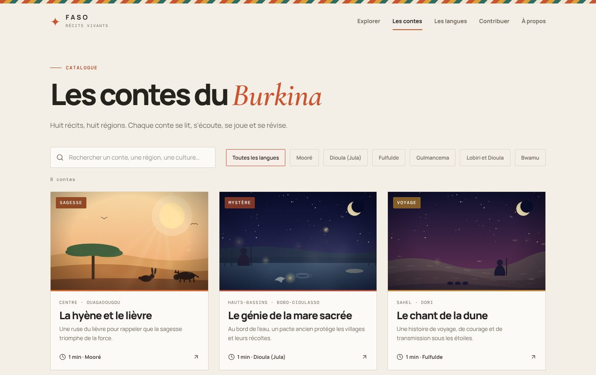
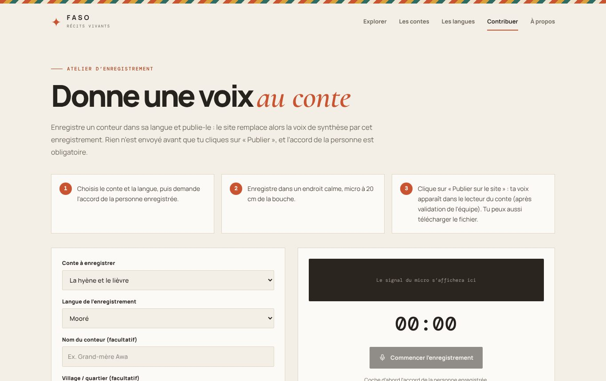
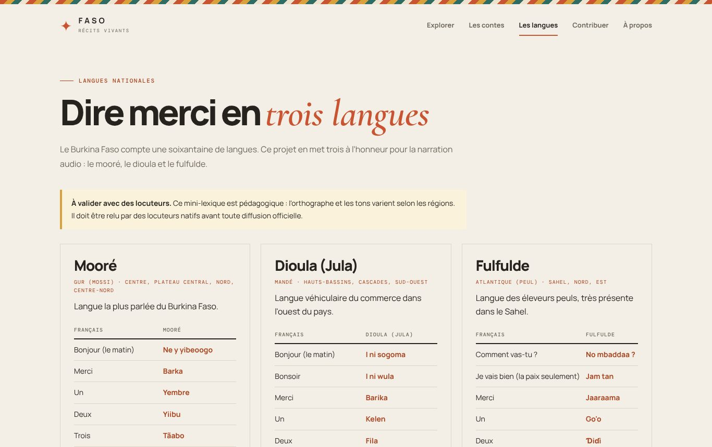
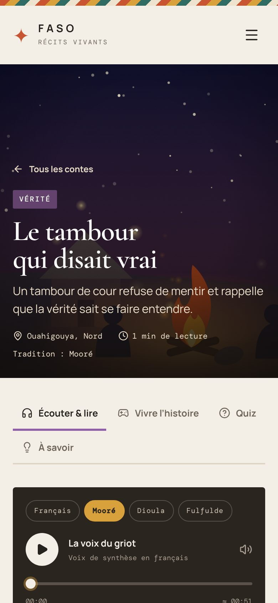
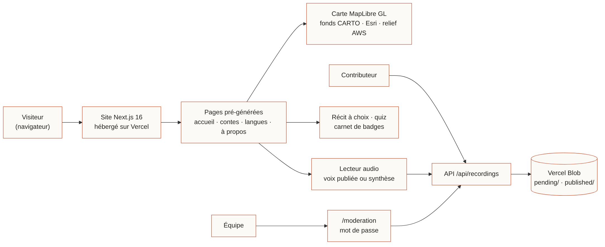
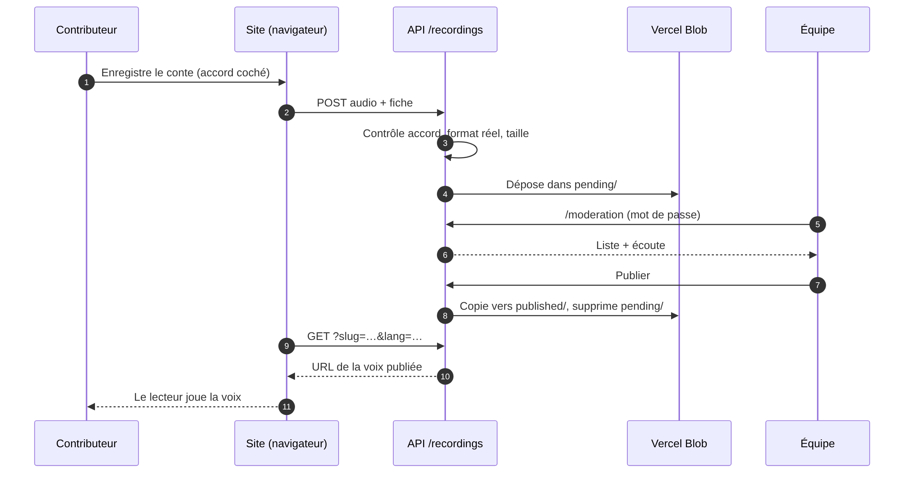

# Faso — Récits vivants

**Plateforme web multimédia et carte interactive des contes et légendes du Burkina Faso**

| | |
|---|---|
| Cours | Multimédia — M1 Informatique, UPDF |
| Groupe | 5 — *Membres : à compléter (noms et prénoms)* |
| Livrable | 4 novembre 2026 |
| Destinataire | Odilon.simpore@gobelab.org |
| **Site en ligne** | **https://tp-multimedia-groupe-5-git-main-abdoulaziztao.vercel.app/** |
| Code source | https://github.com/abdoulaziztao/tp-multimedia-groupe-5 |



---

## Résumé

Faso — Récits vivants est une application web qui **préserve et transmet le patrimoine oral burkinabè** : une carte interactive en relief 3D, huit contes illustrés par des scènes animées, une narration audio en langues nationales, une histoire à embranchements et un quiz. Elle ajoute ce que le sujet ne demandait pas mais qu'un projet de patrimoine exige : un **atelier de collecte de voix** avec consentement et validation par l'équipe, et une accessibilité vérifiée par audit automatique (0 violation sur 6 pages).

## 1. Contexte et objectif

Le sujet demande une plateforme multimédia pour numériser et partager les contes et légendes du Burkina Faso : carte 3D/2D, récits locaux, illustrations animées, bandes sonores en langues nationales (mooré, dioula, fulfulde) et expérience narrative interactive.

Notre fil conducteur : **un conte appartient à un lieu, à une langue et à une voix**. La carte relie le lieu, le lecteur relie la langue et la voix, l'atelier permet de recueillir de vraies voix.

## 2. Conformité au sujet

| Exigence | Réalisation |
|---|---|
| Carte interactive 3D/2D | MapLibre GL (WebGL) : relief réel (modèle numérique de terrain, exagération ×3), bascule 3D ↔ 2D, plan ↔ satellite, **13 régions** cliquables, 8 marqueurs, visite guidée automatique. |
| Contes, légendes, récits locaux | **8 contes** rattachés à 8 régions et cultures (Mossi, Bobo, Peul, Gourmantché, Sénoufo, Lobi, Bwa…), avec contexte culturel et morale. |
| Illustrations animées | **6 décors SVG animés** (savane, mare, dune, cascade, village, forêt) avec jour/nuit, pluie, feu, ondulations ; atmosphère en canvas (lucioles, poussière, sable, brume, braises), parallaxe au pointeur, mouvement de caméra lent, grain et vignettage. Une image générée par IA peut s'ajouter par conte (`docs/IMAGES.md`). |
| Bandes sonores en langues nationales | Lecteur multi-langue (français, mooré, dioula, fulfulde) : **enregistrement réel** s'il existe, sinon synthèse vocale de repli ; texte surligné en synchronisation. Ambiance sonore synthétisée (Web Audio) propre à chaque décor. |
| Expérience narrative interactive | **Histoire à embranchements** (3 types de fins), **quiz**, **carnet du griot** (badges, progression). |
| Rapport + lien | Ce document et l'URL ci-dessus. |



## 3. Au-delà du sujet

- **Atelier d'enregistrement** (`/contribuer`) : enregistrement au micro dans le navigateur, **consentement obligatoire**, puis **publication directe** (Vercel Blob) après **validation** par l'équipe sur `/moderation` (mot de passe). Aucun envoi avant le clic sur « Publier ».
- **Textes en langues nationales** : un conte peut être affiché en mooré (chapitre par chapitre) ; sinon le site l'indique clairement au lieu d'afficher du français en silence.
- **Lexique des langues** (`/langues`), catalogue avec recherche insensible aux accents, progression locale sans compte.
- **SEO et partage** : métadonnées, JSON-LD, sitemap, robots, image Open Graph, manifeste installable.

| Catalogue | Atelier | Langues | Mobile |
|---|---|---|---|
|  |  |  |  |

## 4. Architecture



Le contenu est **statique et pré-généré** (19 routes) ; seule la collecte de voix passe par un petit serveur (API + stockage Blob). Ajouter un conte = ajouter **un objet** dans `lib/stories.ts` : carte, catalogue, page, sitemap, quiz et histoire à choix se mettent à jour seuls.

```
app/                 pages (App Router) et routes API
components/          carte, lecteur, récit à choix, quiz, enregistreur, scènes
lib/stories.ts       corpus des contes (typé) — source de vérité
lib/translations.ts  textes en langues nationales, par conte et par chapitre
lib/recordings.ts    envoi, contrôle, modération des voix (serveur)
lib/use-narration.ts narration : voix publiée ou synthèse, texte synchronisé
public/data/         limites des 13 régions (GeoJSON)
```

### Cycle d'une voix



Le serveur ne fait pas confiance au navigateur : consentement exigé, **type réel du fichier lu sur les premiers octets**, taille de 2 Ko à 4 Mo, champ piège anti-robot, comparaison du mot de passe en temps constant.

## 5. Choix techniques

| Choix | Raison |
|---|---|
| Next.js 16, React 19, TypeScript strict | Pages statiques rapides et indexables ; typage du corpus. |
| MapLibre GL (pas Leaflet) | Seule une carte WebGL offre un vrai relief 3D. |
| SVG + CSS animés | Quelques Ko, nets à toute taille, rien à héberger. |
| Web Audio API | Ambiances générées en direct : aucun fichier à diffuser ni à licencier. |
| MediaRecorder + Vercel Blob | Collecte depuis le navigateur, sans compte pour le contributeur. |
| Polices auto-hébergées | Aucun appel tiers, build reproductible. |
| Worker MapLibre servi localement | Évite l'erreur « Worker failed to load » liée au bundler. |

## 6. Accessibilité et qualité

- Audit **axe-core** (WCAG 2 AA) sur accueil, catalogue, conte, langues, contribuer, à propos : **0 violation** après correction des contrastes, titres et libellés.
- Clavier complet, lien d'évitement, focus visible, marqueurs de carte en `<button>`, liste de repli si WebGL est absent.
- Texte intégral toujours affiché : on ne dépend jamais de l'audio.
- `prefers-reduced-motion` respecté (animations de l'interface, de la scène et de la caméra).
- Responsive de 390 à 1366 px. Typage `tsc` sans erreur, build de production réussi.

## 7. Éthique

Les 8 textes sont des **adaptations originales**, inspirées de thèmes de la tradition orale ouest-africaine ; ils ne prétendent pas reproduire la version d'un conteur précis, et le site le dit. La suite logique est la collecte auprès de vrais conteurs : l'atelier impose le consentement avant tout enregistrement, conserve une fiche de provenance, et rien n'est publié sans validation. Le texte mooré et le lexique doivent être **relus par des locuteurs natifs**.

## 8. Limites connues

1. **Langues nationales** : texte mooré disponible pour un seul conte pour l'instant ; les autres restent en français (avis affiché). L'audio dépend des voix enregistrées ; les synthèses vocales courantes ne lisent pas le mooré, le dioula ni le fulfulde.
2. **Connexion requise** pour les tuiles de la carte.
3. **5 régions sur 13** sans conte (signalées « à collecter »).
4. **Pas de limitation de débit** sur l'envoi : le mode modéré (défaut) est indispensable en diffusion publique.
5. Corpus de 8 textes courts, non validé par des conteurs ou ethnologues.

## 9. Perspectives

Collecte auprès de conteurs avec fiches de provenance ; textes et voix mooré, dioula, fulfulde pour les 8 contes ; couverture des 5 régions restantes ; mode hors-ligne (PWA, tuiles en cache) ; authentification et limitation de débit ; relecture linguistique du lexique.

## 10. Utilisation

```bash
pnpm install
pnpm dev          # http://localhost:3000
pnpm typecheck
pnpm build
```

Parcours de démonstration : accueil → **Relief 3D** + **Visite guidée** → un conte → **Écouter** (ambiance) → **Vivre l'histoire** → **Quiz** → **carnet du griot** → **Contribuer**.

## 11. Transparence sur l'usage de l'IA

Le code et ce rapport ont été réalisés avec l'assistance d'un outil d'IA (Claude), sous la direction du groupe, qui a fourni le sujet, testé le site en ligne, enregistré des voix et rédigé le texte mooré. Les textes des contes sont des créations originales assistées par IA, signalées comme telles sur le site.

## 12. Crédits

Fonds de carte © OpenStreetMap contributors et © CARTO ; imagerie satellite © Esri ; relief Mapzen / AWS Terrain Tiles ; limites geoBoundaries (CC BY 4.0) ; MapLibre GL ; polices Manrope, DM Mono et Cormorant Garamond (SIL OFL).
